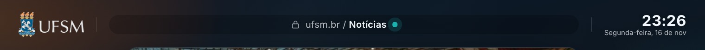
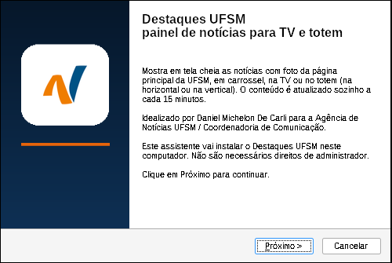
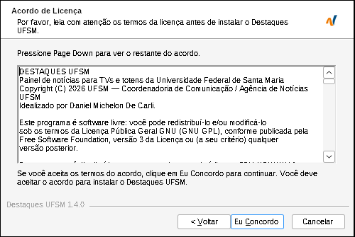

<div align="center">

# Destaques UFSM

**Painel de notícias para TVs e totens da Universidade Federal de Santa Maria**


**[⬇ Baixar a versão mais recente](#download)** · [Todas as versões](https://github.com/danielcarli/Totem-UFSM-noticias/releases) · [Como instalar](#instalação)


</div>

## Sobre o projeto

O **Destaques UFSM** é uma solução feita especificamente para **totens e TVs**: leva para as
telas dos prédios, halls e espaços de convivência as notícias e informações publicadas no site
da Universidade Federal de Santa Maria ([www.ufsm.br](https://www.ufsm.br)).

Idealizado por **Daniel Michelon De Carli**, o software tem a finalidade de trazer uma
**visualização mais moderna para as notícias e os destaques institucionais da UFSM**. Foi
desenvolvido para a **Agência de Notícias UFSM**, da **Coordenadoria de Comunicação da UFSM**.

O painel abre em tela cheia, mostra em carrossel todas as notícias com foto da página principal
do portal e se atualiza sozinho. Depois de instalado, não precisa de ninguém para operar.

## Sumário

- [Download](#download)
- [Telas](#telas)
- [Recursos](#recursos)
- [Instalação](#instalação)
- [TV ou totem funcionando sozinho](#tv-ou-totem-funcionando-sozinho)
- [Uso](#uso)
- [Como funciona](#como-funciona)
- [Desenvolvimento](#desenvolvimento)
- [Versões](#versões)
- [Créditos](#créditos)
- [Licença](#licença)

## Download

Os links abaixo sempre baixam a **versão mais recente** publicada em
[Releases](https://github.com/danielcarli/Totem-UFSM-noticias/releases).

| Sistema | Download |
|---|---|
| **Windows 10 / 11** (64 bits) — instalador | [`Destaques-UFSM-Setup.exe`](https://github.com/danielcarli/Totem-UFSM-noticias/releases/latest/download/Destaques-UFSM-Setup.exe) |
| Windows — portátil, sem instalar | [`Destaques-UFSM-win-x64.zip`](https://github.com/danielcarli/Totem-UFSM-noticias/releases/latest/download/Destaques-UFSM-win-x64.zip) |
| **Debian, Ubuntu, Linux Mint** | [`destaques-ufsm_amd64.deb`](https://github.com/danielcarli/Totem-UFSM-noticias/releases/latest/download/destaques-ufsm_amd64.deb) |
| **Fedora, RHEL, openSUSE** | [`destaques-ufsm.x86_64.rpm`](https://github.com/danielcarli/Totem-UFSM-noticias/releases/latest/download/destaques-ufsm.x86_64.rpm) |
| Qualquer Linux — AppImage, sem instalar | [`Destaques-UFSM-x86_64.AppImage`](https://github.com/danielcarli/Totem-UFSM-noticias/releases/latest/download/Destaques-UFSM-x86_64.AppImage) |
| Navegador — arquivo único | [`destaques-ufsm.html`](https://github.com/danielcarli/Totem-UFSM-noticias/releases/latest/download/destaques-ufsm.html) |

Pelo terminal do Linux (Debian, Ubuntu, Mint):

```bash
wget https://github.com/danielcarli/Totem-UFSM-noticias/releases/latest/download/destaques-ufsm_amd64.deb
sudo apt install ./destaques-ufsm_amd64.deb
```

## Telas

<table>
  <tr>
    <th>TV (horizontal)</th>
    <th>Totem (vertical)</th>
  </tr>
  <tr>
    <td></td>
    <td align="center"></td>
  </tr>
</table>

O painel reconhece a posição da tela. Na **horizontal**, mostra o carrossel com os cards
vizinhos ao fundo, dando uma prévia das próximas notícias. **Em pé**, o card ocupa a tela
inteira, com textos e QR code maiores ("Leia no celular").

<table>
  <tr>
    <th>Banner do topo do portal</th>
    <th>Notícia sem foto</th>
  </tr>
  <tr>
    <td></td>
    <td></td>
  </tr>
</table>

**Identidade institucional.** A marca da UFSM fica no topo; a Coordenadoria de Comunicação e a
Agência de Notícias assinam no rodapé, com a hora da última atualização.




## Recursos

- **Notícias do portal, sempre atualizadas.** Lê a página principal de www.ufsm.br a cada
  15 minutos e mostra todas as notícias com foto: banners do topo, Destaques, Divulga Ciência e
  as demais áreas. Notícia nova entra sozinha; a que saiu do portal sai do painel.
- **Feito para ser visto de longe.** Títulos grandes, editoria e data de cada matéria, e um QR
  code para continuar a leitura no celular.
- **Banners largos animados.** Artes muito largas aparecem inteiras e depois percorrem a imagem
  da esquerda para a direita, terminando antes da troca de card.
- **TV ou totem.** Layout horizontal ou vertical automático, conforme a tela.
- **Vários monitores.** As teclas **1**, **2** e **3** levam o painel para o monitor escolhido, e
  ele lembra a escolha nas próximas aberturas.
- **Funciona sozinho, o dia todo.** Abre em tela cheia, impede que a tela apague, continua
  mostrando as últimas notícias se a internet cair (e tenta de novo a cada minuto), se recupera
  de travamentos, se recarrega uma vez por dia e pode abrir sozinho ao ligar o computador.
- **Modo noite.** Opcionalmente, deixa a tela preta em um horário (ex.: das 23h às 6h).
- **Só lê o site.** Não envia nenhum dado sobre o computador ou sobre quem está diante da tela.

## Instalação

| Sistema | Arquivo | Como instalar |
|---|---|---|
| **Windows 10 / 11** (64 bits) | [`Destaques-UFSM-Setup.exe`](https://github.com/danielcarli/Totem-UFSM-noticias/releases/latest/download/Destaques-UFSM-Setup.exe) | Dê dois cliques e siga o assistente. Não precisa de administrador. |
| Windows, sem instalar | [`Destaques-UFSM-win-x64.zip`](https://github.com/danielcarli/Totem-UFSM-noticias/releases/latest/download/Destaques-UFSM-win-x64.zip) | Descompacte e abra `DestaquesUFSM.exe`. |
| **Debian, Ubuntu, Linux Mint** | [`destaques-ufsm_amd64.deb`](https://github.com/danielcarli/Totem-UFSM-noticias/releases/latest/download/destaques-ufsm_amd64.deb) | `sudo apt install ./destaques-ufsm_amd64.deb` |
| **Fedora, RHEL, openSUSE** | [`destaques-ufsm.x86_64.rpm`](https://github.com/danielcarli/Totem-UFSM-noticias/releases/latest/download/destaques-ufsm.x86_64.rpm) | `sudo dnf install ./destaques-ufsm.x86_64.rpm` |
| Qualquer Linux, sem instalar | [`Destaques-UFSM-x86_64.AppImage`](https://github.com/danielcarli/Totem-UFSM-noticias/releases/latest/download/Destaques-UFSM-x86_64.AppImage) | `chmod +x Destaques-UFSM-x86_64.AppImage` e abra o arquivo. |

Para atualizar, baixe e instale a versão nova por cima da anterior: as configurações e a
abertura automática são mantidas.

### Instalador do Windows

Assistente em português, com licença, escolha da pasta e, na última tela, a opção de abrir o
painel sozinho sempre que o Windows iniciar, para TVs e totens. Cria atalhos na área de trabalho
e no menu Iniciar; para remover, use **Configurações › Aplicativos › Destaques UFSM**.

<table>
  <tr>
    <td></td>
    <td></td>
  </tr>
  <tr>
    <td></td>
    <td></td>
  </tr>
</table>

> Os instaladores ainda não têm assinatura digital. Na primeira vez, o Windows pode mostrar
> "O Windows protegeu o computador": clique em **Mais informações › Executar assim mesmo**.

## TV ou totem funcionando sozinho

1. **Abrir sozinho.** No Windows, marque a opção na última tela do instalador. No Linux, rode uma
   vez (sem `sudo`), como o usuário que fica logado na TV:
   ```bash
   destaques-ufsm --iniciar-com-sistema --password-store=basic
   ```
   O `--password-store=basic` evita a janela "Desbloquear chaveiro" quando o login é automático.
2. **Login automático** do usuário, sem pedir senha. Linux Mint/Ubuntu: Menu › Administração ›
   Janela de início de sessão › Usuários › Login automático. Windows: `netplwiz`.
3. **Tela que não apaga.** O painel já impede o descanso de tela, mas desligue também a proteção
   de tela e o bloqueio nas configurações de energia.
4. **Volta após falta de luz.** Na BIOS, ajuste "Restore on AC Power Loss" para **Power On**.

## Uso

### Atalhos

| Tecla | Ação |
|---|---|
| ← / → | notícia anterior / próxima |
| Espaço | pausa / continua |
| R | busca as notícias agora |
| 1 / 2 / 3 | leva o painel para o monitor 1, 2 ou 3 (da esquerda para a direita) e lembra a escolha |
| F11 / Esc | entra / sai da tela cheia |
| Ctrl+R | recarrega o painel |
| Ctrl+Q | fecha o aplicativo |

Em telas de toque, deslize o dedo para os lados para trocar de notícia.

### Opções

Acrescente ao atalho (Windows, campo "Destino") ou ao comando (Linux):

| Opção | O que faz |
|---|---|
| `--monitor=2` | abre no segundo monitor só desta vez (para fixar, use as teclas 1, 2, 3) |
| `--intervalo=10` | segundos por notícia (padrão 7) |
| `--atualizacao=10` | minutos entre as leituras do portal (padrão 15) |
| `--max=30` | número máximo de notícias |
| `--secoes=Destaques,JAI` | mostra só estas áreas da página principal |
| `--ignorar="Em destaque"` | tira áreas (ex.: os banners do topo) |
| `--orientacao=vertical` | força o layout de totem (normalmente é automático) |
| `--leve=1` | sem efeitos de desfoque, para computadores mais fracos |
| `--noite=23-6` | tela preta das 23h às 6h |
| `--iniciar-com-sistema` | passa a abrir sozinho ao entrar no computador (guarda as outras opções) |
| `--nao-iniciar-com-sistema` | desfaz a opção acima |

Exemplo no Windows: `"%LOCALAPPDATA%\Programs\DestaquesUFSM\DestaquesUFSM.exe" --intervalo=8`

### Versão para navegador

[`destaques-ufsm.html`](navegador/destaques-ufsm.html) é o mesmo painel em um único arquivo, para abrir em qualquer navegador
(Chrome ou Edge em modo quiosque, por exemplo). As opções vão no endereço:
`destaques-ufsm.html?intervalo=10&orientacao=vertical`. A troca de monitor pelas teclas 1, 2 e 3
existe só no aplicativo.

## Como funciona

```
 www.ufsm.br ──(API pública do WordPress, a cada 15 min)──▶ painel (HTML + JavaScript)
                                                             │
                     lê a página principal, encontra as matérias com foto,
                     escolhe a melhor imagem e monta o carrossel
                                                             │
                                                             ▼
                          aplicativo Electron: tela cheia, tela sempre acesa,
                          abrir com o sistema, monitores, recuperação automática
```

O painel é uma página HTML + JavaScript que roda no próprio computador da TV. Ele lê a página
principal do portal pela API pública do WordPress da UFSM, identifica as matérias com foto
(endereços no formato `/AAAA/MM/DD/titulo`), escolhe a melhor imagem de cada uma e monta o
carrossel. O aplicativo para Windows e Linux é feito com [Electron](https://www.electronjs.org):
ele abre essa página em tela cheia e cuida do que um navegador comum não faz sozinho.

## Desenvolvimento

Requisitos: [Node.js LTS](https://nodejs.org) e [Git](https://git-scm.com).

```bash
git clone https://github.com/danielcarli/Totem-UFSM-noticias.git
cd Totem-UFSM-noticias
npm install
npm start            # abre o painel
npm run painel       # gera app/index.html e navegador/destaques-ufsm.html a partir de painel/
npm run dist:win     # instalador (Setup.exe) e versão portátil (.zip) do Windows
npm run dist:linux   # .deb, .rpm e AppImage
npm run dist         # todos
```

Os arquivos ficam em `dist/`, já com os nomes usados nos links de [Download](#download).
Os instaladores são gerados com [electron-builder](https://www.electron.build) (no Windows, com
o NSIS). Para gerar o `.rpm` é
preciso o `rpmbuild` (pacote `rpm`); para gerar o instalador do Windows a partir do Linux, o
`wine`.

### Estrutura do projeto

O painel é editado em **`painel/template.html`**. Depois de mudar o template ou as marcas,
rode `npm run painel` (os comandos `dist` já fazem isso).

```
painel/template.html   o painel: HTML, CSS e JavaScript (é aqui que se edita)
painel/marcas/         marcas da UFSM, da Coordenadoria e da Agência usadas no painel
scripts/               geração do painel a partir do template
main.js                aplicativo Electron (janela, atalhos, opções, monitores, abrir com o sistema)
app/index.html         o painel gerado para o aplicativo (fontes e QR code locais)
navegador/             o painel gerado em arquivo único, para navegador
app/fontes/            fonte Barlow
app/vendor/            gerador de QR code
build/                 ícones, licença e personalização do instalador do Windows
docs/                  imagens deste README
LEIA-ME.txt            instruções que acompanham os instaladores
.github/workflows/     geração e publicação automática dos instaladores
```

### Publicar uma versão

1. Atualize `"version"` no `package.json` e a tabela de [Versões](#versões).
2. Crie e envie a tag da versão: `git tag v1.4.4 && git push origin v1.4.4`.
3. O GitHub Actions ([`.github/workflows/release.yml`](.github/workflows/release.yml)) gera os
   instaladores de Windows e Linux e os publica na release da tag. Os links de
   [Download](#download) passam a apontar para ela.

Também dá para publicar à mão: gere com `npm run dist`, crie a release em
[Releases](https://github.com/danielcarli/Totem-UFSM-noticias/releases/new) e anexe os arquivos
de `dist/` e o `navegador/destaques-ufsm.html`, com os mesmos nomes.

## Versões

| Versão | Novidades |
|---|---|
| **1.4.4** | Notícias com GIF animado como imagem de destaque (ex.: "Lembre bem") também aparecem, com a animação no card; nesses casos o fundo desfocado não usa o GIF, para não pesar na placa de vídeo. |
| **1.4.3** | Corrige imagens piscando nas transições depois de várias trocas seguidas pelo teclado: o fundo desfocado troca sem piscar, os cards fora da tela deixam de ocupar a placa de vídeo (cerca de 1/3 menos área desenhada) e o card que chega ao centro só passa à frente quando cruza o anterior. |
| **1.4.2** | O título da matéria fica sempre embaixo da imagem: saiu a troca de posição com as setas ↑/↓ (e a opção `--layout`). |
| **1.4.1** | Banners do carrossel do topo que levam a uma página ou site (ex.: Descubra UFSM), e não a uma matéria, também entram no painel; correção da geração automática no Windows (GitHub Actions). |
| **1.4.0** | Instalador assistido para Windows (com opção de abrir ao iniciar) e pacotes `.deb`, `.rpm` e AppImage para Linux; teclas 1, 2 e 3 para trocar de monitor, com memória da escolha; hora da última atualização só no rodapé; licença GNU GPL 3. |
| **1.3.0** | Marca da UFSM no topo; Coordenadoria de Comunicação e Agência de Notícias no rodapé; card de notícia sem foto com mais contraste. |
| **1.2.0** | Layout para totem vertical, QR code maior, toque na tela, modo noite, recarga diária, instalador `.deb`. |

## Créditos

Idealizado por **Daniel Michelon De Carli**, para a Agência de Notícias UFSM / Coordenadoria de
Comunicação da UFSM.

Encontrou um problema ou tem uma sugestão? Abra uma [issue](https://github.com/danielcarli/Totem-UFSM-noticias/issues).

## Licença

Copyright © 2026 UFSM — Coordenadoria de Comunicação / Agência de Notícias UFSM.

Este programa é software livre, distribuído sob a **GNU General Public License, versão 3** ou
(a seu critério) qualquer versão posterior. Veja o arquivo [LICENSE](LICENSE).

As marcas da UFSM, da Coordenadoria de Comunicação e da Agência de Notícias **não** são cobertas
por essa licença: pertencem à UFSM e só podem ser usadas conforme o manual de identidade visual
da instituição. As notícias e fotos exibidas pertencem aos seus autores e à UFSM.

Componentes de terceiros: Electron (MIT), Chromium (BSD e outras), fonte Barlow
(SIL Open Font License 1.1) e qrcode-generator (MIT).
