<div align="center">

# Destaques UFSM

**Painel de notícias para TVs e totens da Universidade Federal de Santa Maria**


**[⬇ Baixar a versão mais recente](#download)** · [Todas as versões](https://github.com/danielcarli/Totem-UFSM-noticias/releases) · [Como instalar](#instalação)

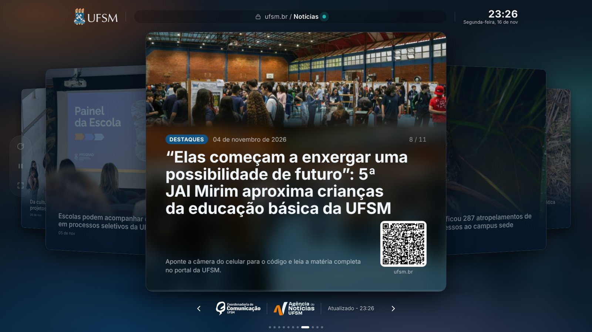

</div>

## Sobre o projeto

O **Destaques UFSM** é uma solução feita especificamente para **totens e TVs**: leva para as
telas dos prédios, halls e espaços de convivência as notícias e informações publicadas no site
da Universidade Federal de Santa Maria ([www.ufsm.br](https://www.ufsm.br)).

Idealizado por **Daniel Michelon De Carli**, o software tem a finalidade de trazer uma
**visualização mais moderna para as notícias e os destaques institucionais da UFSM**. Foi
desenvolvido para a **Agência de Notícias UFSM**, da **Coordenadoria de Comunicação da UFSM**.

O painel abre em tela cheia, mostra em carrossel todas as notícias com foto da página principal
do portal e se atualiza sozinho. Depois de instalado, não precisa de ninguém para operar.

## Sumário

- [Download](#download)
- [Telas](#telas)
- [Recursos](#recursos)
- [Instalação](#instalação)
- [TV ou totem funcionando sozinho](#tv-ou-totem-funcionando-sozinho)
- [Sistema próprio (Linux para TVs e totens)](#sistema-próprio-linux-para-tvs-e-totens)
- [Configurações](#configurações)
- [Uso](#uso)
- [Como funciona](#como-funciona)
- [Desenvolvimento](#desenvolvimento)
- [Versões](#versões)
- [Sugestões por fazer](#sugestões-por-fazer)
- [Créditos](#créditos)
- [Licença](#licença)

## Download

Os links abaixo sempre baixam a **versão mais recente** publicada em
[Releases](https://github.com/danielcarli/Totem-UFSM-noticias/releases).

| Sistema | Download |
|---|---|
| **Windows 10 / 11** (64 bits) — instalador | [`Destaques-UFSM-Setup.exe`](https://github.com/danielcarli/Totem-UFSM-noticias/releases/latest/download/Destaques-UFSM-Setup.exe) |
| Windows — portátil, sem instalar | [`Destaques-UFSM-win-x64.zip`](https://github.com/danielcarli/Totem-UFSM-noticias/releases/latest/download/Destaques-UFSM-win-x64.zip) |
| **Debian, Ubuntu, Linux Mint** | [`destaques-ufsm_amd64.deb`](https://github.com/danielcarli/Totem-UFSM-noticias/releases/latest/download/destaques-ufsm_amd64.deb) |
| **Fedora, RHEL, openSUSE** | [`destaques-ufsm.x86_64.rpm`](https://github.com/danielcarli/Totem-UFSM-noticias/releases/latest/download/destaques-ufsm.x86_64.rpm) |
| Qualquer Linux — AppImage, sem instalar | [`Destaques-UFSM-x86_64.AppImage`](https://github.com/danielcarli/Totem-UFSM-noticias/releases/latest/download/Destaques-UFSM-x86_64.AppImage) |
| **Sistema próprio** — Linux que liga direto no painel, para PCs e notebooks dedicados (64 bits) | [`Destaques-UFSM-Sistema-amd64.iso`](https://github.com/danielcarli/Totem-UFSM-noticias/releases/latest/download/Destaques-UFSM-Sistema-amd64.iso) — veja [Sistema próprio](#sistema-próprio-linux-para-tvs-e-totens) |
| Navegador — arquivo único | [`destaques-ufsm.html`](https://github.com/danielcarli/Totem-UFSM-noticias/releases/latest/download/destaques-ufsm.html) |

Pelo terminal do Linux (Debian, Ubuntu, Mint):

```bash
wget https://github.com/danielcarli/Totem-UFSM-noticias/releases/latest/download/destaques-ufsm_amd64.deb
sudo apt install ./destaques-ufsm_amd64.deb
```

## Telas

<table>
  <tr>
    <th>TV (horizontal)</th>
    <th>Totem (vertical)</th>
  </tr>
  <tr>
    <td></td>
    <td align="center">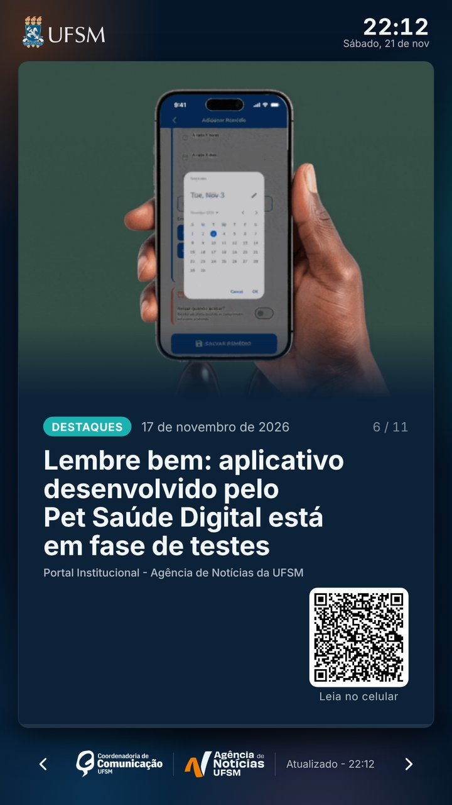</td>
  </tr>
</table>

O painel reconhece a posição da tela. Na **horizontal**, mostra o carrossel com os cards
vizinhos ao fundo, dando uma prévia das próximas notícias. **Em pé**, o card ocupa a tela
inteira, com textos e QR code maiores ("Leia no celular").

<table>
  <tr>
    <th>Banner do topo do portal</th>
    <th>Notícia sem foto</th>
  </tr>
  <tr>
    <td>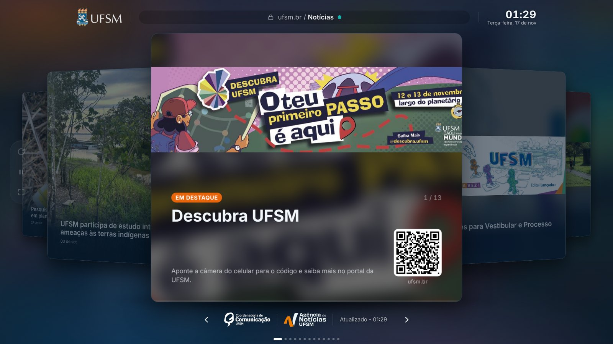</td>
    <td>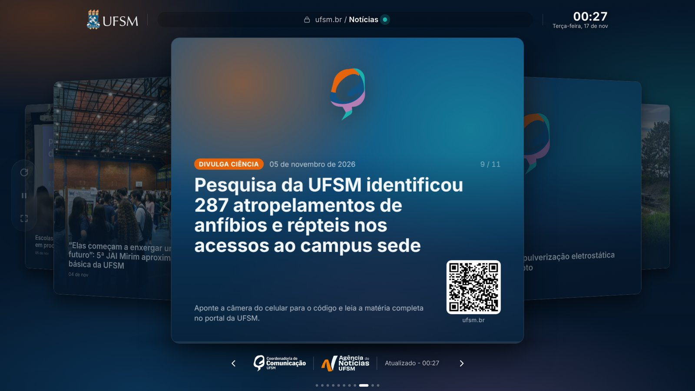</td>
  </tr>
</table>

**Identidade institucional.** A marca da UFSM fica no topo; a Coordenadoria de Comunicação e a
Agência de Notícias, que desenvolve o painel, assinam no rodapé, com a hora da última atualização
e, bem discreta embaixo dela, a versão do painel (ex.: `v1.9.4`) — útil para saber se uma TV já
recebeu a atualização.
Abaixo do título de cada matéria aparece o **site de onde ela vem**: o portal da UFSM é formado por
muitos subsites (pró-reitorias, centros, cursos), e as matérias da página principal são da
Agência — nelas aparece "Agência de Notícias UFSM - Portal Institucional".


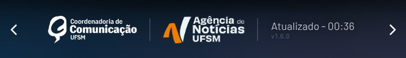

## Recursos

- **Notícias do portal, sempre atualizadas.** Lê a página principal de www.ufsm.br a cada
  15 minutos e mostra todas as notícias com foto: banners do topo, Destaques, Divulga Ciência e
  as demais áreas. Notícia nova entra sozinha; a que saiu do portal sai do painel. Se a página
  tiver menos notícias com foto que o configurado (12), completa com as últimas matérias do portal.
- **Notícias de outros sites da UFSM.** Pela tela de configurações, entram também as matérias do
  Gabinete da Reitoria, das pró-reitorias, das diretorias (DTI e DRI), das unidades de ensino,
  dos campi e das mídias da UFSM (Rádios, TV Campus e Revista .TXT).
- **Vídeos da página principal.** Os vídeos do YouTube incorporados em www.ufsm.br (ex.: a seção
  TV Campus) entram no carrossel com o título do YouTube, a capa na maior resolução que o vídeo
  tiver (1280 px, senão 640 ou 480) e, no lugar da autoria, o nome do canal do YouTube onde o
  vídeo está publicado (ex.: *TV Campus UFSM*), com um símbolo de vídeo. O QR leva ao vídeo.

  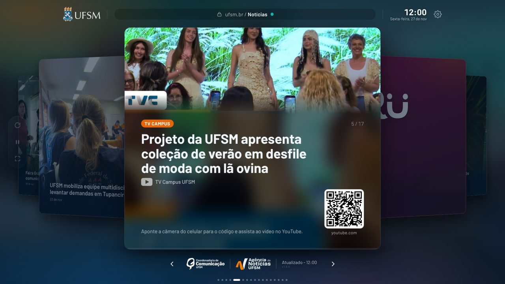

- **Cardápio do RU.** A cada 7 notícias entra um card com a refeição do momento (café, almoço
  ou jantar) do Restaurante Universitário escolhido, com a marca do RU, as cores dela e um ícone
  para cada categoria de alimento. Fica 10 segundos na tela (os dois valores mudam na engrenagem).
- **Previsão do tempo.** Com a cidade da TV configurada (Santa Maria, Frederico Westphalen,
  Palmeira das Missões ou Cachoeira do Sul), um ícone e a temperatura aparecem ao lado do relógio.
- **Rádio UNIFM 107,9 ao vivo (opcional).** Um player discreto, na identidade da UNIFM, na
  lateral direita da tela (no totem, no topo). Desligado por padrão; liga-se na engrenagem.
- **Feito para ser visto de longe.** Títulos grandes, editoria, data e site de origem de cada
  matéria, e um QR code para continuar a leitura no celular.
- **Marca de quem publicou.** Ao lado do site de origem aparece, discreto e na cor do texto, o
  símbolo da unidade, conforme a [identidade institucional](https://www.ufsm.br/identidade-institucional):
  Agência de Notícias no portal, símbolo próprio dos centros e colégios (CAL, CCNE, CCR, CCS,
  CCSH, CE, CEFD, CT, CTISM e Politécnico) e o brasão da UFSM em linhas para o Gabinete, as
  pró-reitorias, as diretorias, os campi e qualquer outro site da UFSM sem símbolo próprio.
- **Só notícia recente.** Matérias publicadas há mais de 30 dias não entram no carrossel
  (opção `--dias`).
- **QR code simples de ler.** Matérias do WordPress usam o link curto do próprio site
  (`www.ufsm.br/?p=74889`, que abre a mesma matéria), e o código usa correção de erro baixa
  (na tela ele não se suja nem amassa): cerca de metade dos quadradinhos de antes.
- **Leituras do QR code medidas.** O endereço do QR leva `utm_source=tv`, `utm_medium=qr` e
  `utm_campaign=<local>`: no Google Analytics do portal dá para ver quantas pessoas leram matérias
  a partir dos painéis, e de qual painel (opção `--local`). Até a versão 1.9.1 os valores eram
  `painel-destaques` e `qrcode`. Sem essa marcação (opção `--utm=0`) o QR fica ainda mais simples.
- **Banners largos animados.** Artes muito largas aparecem inteiras e depois percorrem a imagem
  da esquerda para a direita, terminando antes da troca de card.
- **TV ou totem.** Layout horizontal ou vertical automático, conforme a tela.
- **Vários monitores.** As teclas **1**, **2** e **3** levam o painel para o monitor escolhido, e
  ele lembra a escolha nas próximas aberturas.
- **Funciona sozinho, o dia todo.** Abre em tela cheia, impede que a tela apague, continua
  mostrando as últimas notícias se a internet cair (e tenta de novo a cada minuto), se recupera
  de travamentos, se recarrega uma vez por dia e pode abrir sozinho ao ligar o computador.
- **Atualização automática.** O aplicativo procura versões novas nas
  [Releases](https://github.com/danielcarli/Totem-UFSM-noticias/releases) e, no Windows e no
  AppImage, instala sozinho às 4h30 da manhã, voltando a abrir com as mesmas opções. Nos pacotes
  `.deb` e `.rpm` (que pedem senha de administrador para atualizar), mostra um aviso discreto.
- **Resistente a mudanças no portal.** Se o layout da página principal mudar e o painel achar
  poucas notícias, ele completa com as últimas matérias com foto, direto pela API do WordPress
  (plano B). E um teste diário no GitHub avisa por e-mail quando isso acontece.
- **Modo noite.** Opcionalmente, deixa a tela preta em um horário (ex.: das 23h às 6h).
- **Só lê o site.** Não envia nenhum dado sobre o computador ou sobre quem está diante da tela.
  Com a rádio UNIFM ligada, também recebe o áudio do servidor da transmissão
  (`stream3.svrdedicado.org`), como qualquer player da rádio. O cardápio vem do Portal do RU
  (`portal.ufsm.br`) e a previsão do tempo, do [Open-Meteo](https://open-meteo.com)
  (só as coordenadas do campus vão na consulta).

## Instalação

| Sistema | Arquivo | Como instalar |
|---|---|---|
| **Windows 10 / 11** (64 bits) | [`Destaques-UFSM-Setup.exe`](https://github.com/danielcarli/Totem-UFSM-noticias/releases/latest/download/Destaques-UFSM-Setup.exe) | Dê dois cliques e siga o assistente. Não precisa de administrador. |
| Windows, sem instalar | [`Destaques-UFSM-win-x64.zip`](https://github.com/danielcarli/Totem-UFSM-noticias/releases/latest/download/Destaques-UFSM-win-x64.zip) | Descompacte e abra `DestaquesUFSM.exe`. |
| **Debian, Ubuntu, Linux Mint** | [`destaques-ufsm_amd64.deb`](https://github.com/danielcarli/Totem-UFSM-noticias/releases/latest/download/destaques-ufsm_amd64.deb) | `sudo apt install ./destaques-ufsm_amd64.deb` |
| **Fedora, RHEL, openSUSE** | [`destaques-ufsm.x86_64.rpm`](https://github.com/danielcarli/Totem-UFSM-noticias/releases/latest/download/destaques-ufsm.x86_64.rpm) | `sudo dnf install ./destaques-ufsm.x86_64.rpm` |
| Qualquer Linux, sem instalar | [`Destaques-UFSM-x86_64.AppImage`](https://github.com/danielcarli/Totem-UFSM-noticias/releases/latest/download/Destaques-UFSM-x86_64.AppImage) | `chmod +x Destaques-UFSM-x86_64.AppImage` e abra o arquivo. |

Para atualizar, baixe e instale a versão nova por cima da anterior: as configurações e a
abertura automática são mantidas.

### Instalador do Windows

Assistente em português, com licença, escolha da pasta e, na última tela, a opção de abrir o
painel sozinho sempre que o Windows iniciar, para TVs e totens. Cria atalhos na área de trabalho
e no menu Iniciar; para remover, use **Configurações › Aplicativos › Destaques UFSM**.

<table>
  <tr>
    <td></td>
    <td></td>
  </tr>
  <tr>
    <td>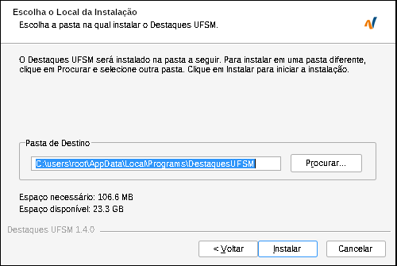</td>
    <td>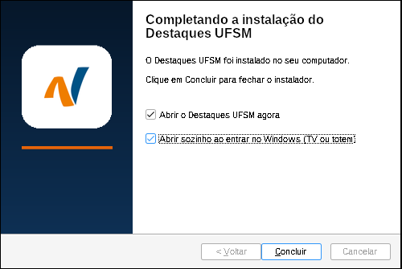</td>
  </tr>
</table>

> Os instaladores ainda não têm assinatura digital. Na primeira vez, o Windows pode mostrar
> "O Windows protegeu o computador": clique em **Mais informações › Executar assim mesmo**.

## TV ou totem funcionando sozinho

1. **Abrir sozinho.** No Windows, marque a opção na última tela do instalador. No Linux, rode uma
   vez (sem `sudo`), como o usuário que fica logado na TV:
   ```bash
   destaques-ufsm --iniciar-com-sistema --password-store=basic
   ```
   O `--password-store=basic` evita a janela "Desbloquear chaveiro" quando o login é automático.
2. **Login automático** do usuário, sem pedir senha. Linux Mint/Ubuntu: Menu › Administração ›
   Janela de início de sessão › Usuários › Login automático. Windows: `netplwiz`.
3. **Tela que não apaga.** O painel já impede o descanso de tela, mas desligue também a proteção
   de tela e o bloqueio nas configurações de energia.
4. **Volta após falta de luz.** Na BIOS, ajuste "Restore on AC Power Loss" para **Power On**.

## Sistema próprio (Linux para TVs e totens)

Para um computador que fica só por conta da TV ou do totem, há uma imagem pronta:
**[`Destaques-UFSM-Sistema-amd64.iso`](https://github.com/danielcarli/Totem-UFSM-noticias/releases/latest/download/Destaques-UFSM-Sistema-amd64.iso)**
— um Debian 13 enxuto que **liga direto no painel**, sem área de trabalho, com só o necessário:
vídeo (placas antigas e novas), rede cabeada e Wi-Fi, Bluetooth, som, mouse e teclado.

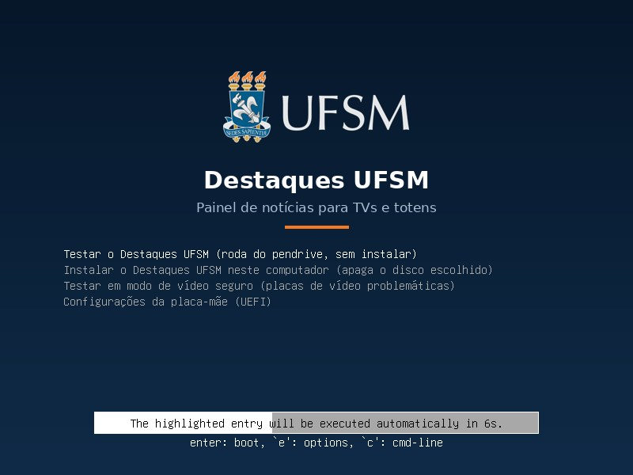
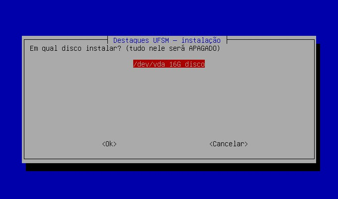

- **Instala em PCs e notebooks antigos** de 64 bits (BIOS ou UEFI, 2 GB de RAM, 8 GB de disco):
  grave a ISO num pendrive, ligue por ele e escolha **Instalar**. Também dá para **testar** sem
  instalar.
- **Notebook com a TV:** usa as duas telas — o painel vai para a TV (monitor 1) — e continua
  funcionando com a tampa fechada.
- **Configura tudo pela engrenagem do painel**, no mesmo visual: rede cabeada (DHCP ou endereço
  fixo), Wi-Fi (inclusive com usuário e senha, como eduroam), Bluetooth, saída de som e volume,
  telas do notebook e horário de funcionamento.
- **Horário de funcionamento:** fora do expediente do setor, a tela apaga e o computador
  **suspende**, gastando quase nada; o relógio da placa-mãe liga tudo sozinho 2 minutos antes de
  abrir. Em máquinas que não voltam bem da suspensão, só apaga a tela.
- **Atualiza sozinho** pela página de Releases do GitHub (15 minutos depois de ligar e todo dia às
  4h30), conferindo os arquivos com o SHA-256 da release; a versão anterior fica guardada.
- **Recuperação:** se o painel fechar seguidas vezes, o sistema força a atualização sozinho. Para
  entrar à mão: **Ctrl+Alt+F2** (ou a opção *recuperação* do menu de inicialização), com PIN —
  forçar atualização, voltar à versão anterior, configurar a rede, diagnóstico, restaurar padrão.
- O cursor do mouse some depois de 1 minuto parado.

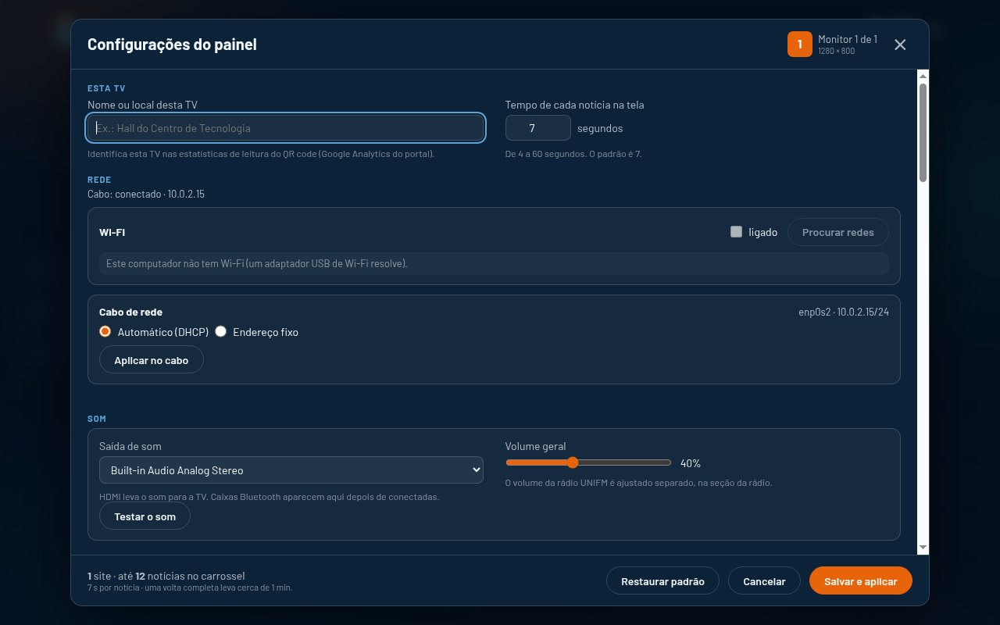
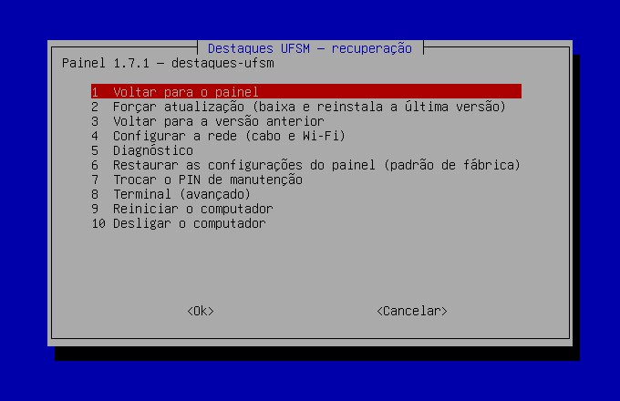

O guia completo — gravar o pendrive, instalar, horário, atualização, recuperação e arquivos de
configuração — está em **[`sistema/LEIA-ME.md`](sistema/LEIA-ME.md)**.

## Configurações

Tudo o que muda de uma TV para outra — de onde vêm as notícias, quantas de cada site, o nome da
TV e o monitor — é ajustado na própria tela, sem editar arquivos nem atalhos. A configuração fica
guardada no computador da TV (na versão para navegador, no próprio navegador) e continua valendo
depois de fechar o painel, reiniciar o computador ou atualizar o programa.

### Como abrir

Clique na **engrenagem** ao lado do relógio, no canto superior direito, ou pressione a tecla **C**.
A engrenagem fica semitransparente para não chamar atenção de quem está só lendo as notícias.

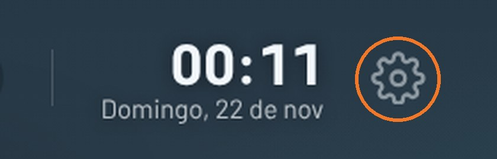

Enquanto a tela de configurações está aberta, o carrossel para e as teclas servem só para os
campos (as teclas 1, 2 e 3 não trocam de monitor, por exemplo). **Esc**, **Cancelar** ou o **×**
fecham sem mudar nada.

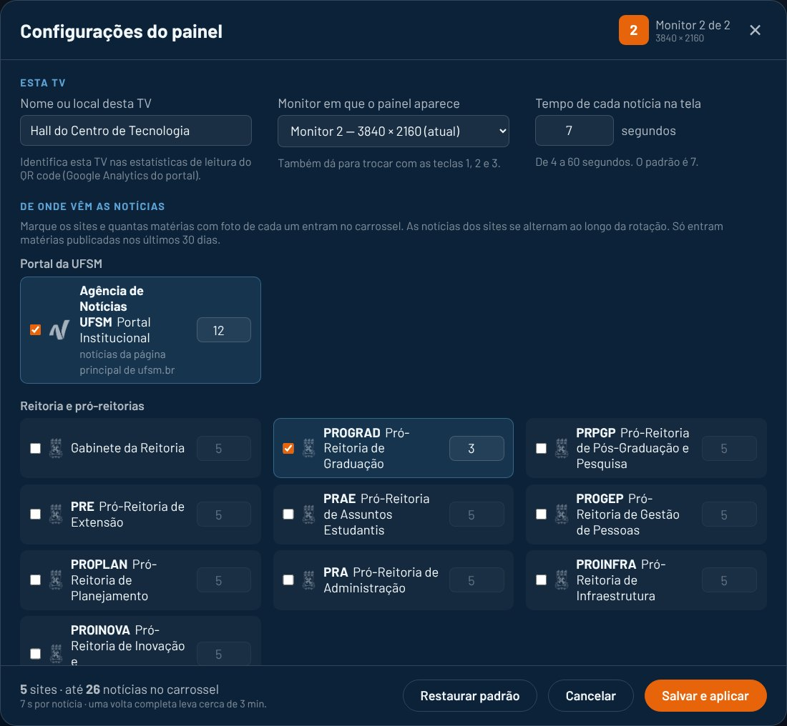

### Esta TV

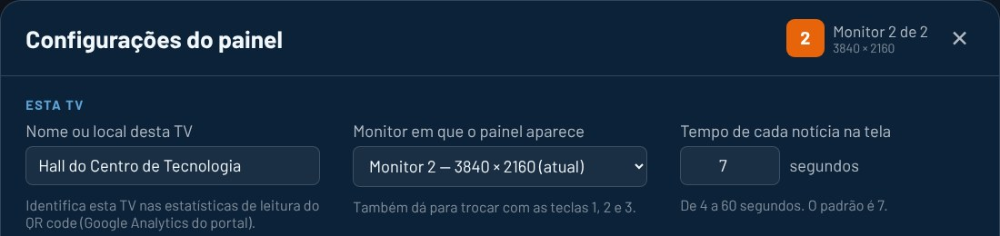

- **Monitor atual.** O quadrado laranja no topo mostra em qual monitor o painel está aberto
  (ex.: *Monitor 2 de 2*) e a resolução dele. Aparece sempre no aplicativo, mesmo com um monitor só.
- **Nome ou local desta TV.** Identifica a TV nas estatísticas do QR code: o nome vira o
  `utm_campaign` do endereço (ex.: *Hall do Centro de Tecnologia* → `hall-do-centro-de-tecnologia`).
  No Google Analytics do portal dá para ver quantas leituras vieram de cada painel. Em branco, fica `ufsm`.
- **Monitor em que o painel aparece.** Só aparece no aplicativo, quando o computador tem mais de
  um monitor. A escolha é lembrada nas próximas vezes que o painel abrir. As teclas **1**, **2** e
  **3** fazem o mesmo fora da tela de configurações.
- **Cidade desta TV.** Santa Maria, Frederico Westphalen, Palmeira das Missões ou Cachoeira do
  Sul. Com uma cidade escolhida, a previsão do tempo aparece no canto superior direito, ao lado do
  relógio: ícone do tempo agora (sol, nuvens, chuva, temporal… e lua à noite), a temperatura e a
  máxima/mínima do dia. Atualiza a cada 30 minutos. Os dados são do
  [Open-Meteo](https://open-meteo.com) (gratuito para uso não comercial, licença CC BY 4.0).
  Em branco (padrão), a previsão não aparece. Opção de linha de comando: `--cidade=santa-maria`.

  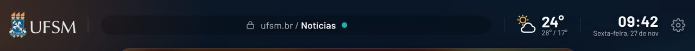

- **Tempo de cada notícia na tela.** Quantos segundos cada notícia fica no centro antes de passar
  para a próxima — de 4 a 60, padrão 10. Vale também para a barra de progresso e para a animação
  dos banners largos. Se o atalho do painel tiver a opção `--intervalo`, o campo fica travado e
  vale o valor da opção.

### Rádio UNIFM 107,9

O painel pode tocar ao vivo a [UNIFM 107,9](https://www.ufsm.br/orgaos-suplementares/radio), a
rádio da UFSM. **Vem desligado**: marque *Mostrar o player da rádio no painel* e salve.

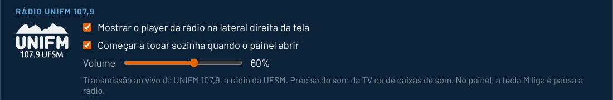

- **Começar a tocar sozinha quando o painel abrir** — para TVs e totens sem ninguém por perto.
  No aplicativo, a rádio começa sozinha. No navegador, que só libera som depois de um toque, o
  player pisca *Toque para ouvir* até o primeiro toque ou tecla — no Chrome ou Edge em modo
  quiosque, a opção `--autoplay-policy=no-user-gesture-required` libera o som automático.
- **Volume** — muda na hora enquanto arrasta, para testar no som da TV (Cancelar desfaz).

O player fica na lateral direita, no mesmo estilo de vidro do painel, com a marca da UNIFM
(versão negativa, branca) e o laranja da marca no equalizador. No totem (vertical), vira uma
faixa no topo, entre a marca da UFSM e o relógio. Sem ninguém mexendo no mouse, ele fica
semitransparente.

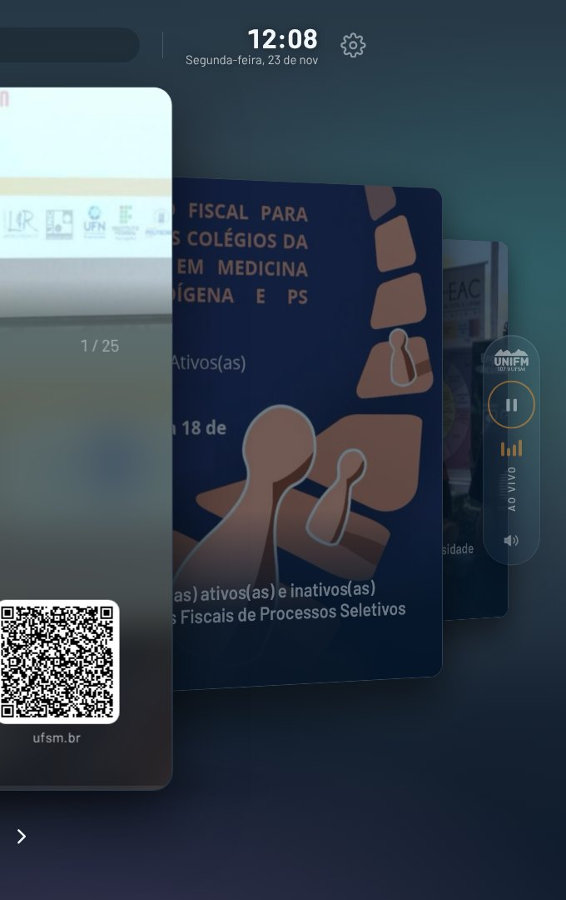
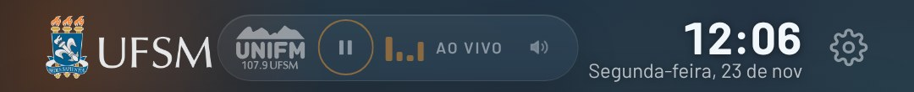

- **▶ / ❚❚** liga e pausa (ou a tecla **M**); o alto-falante tira e devolve o som.
- *Ao vivo* com o equalizador mexendo = tocando. *Conectando* ou *Reconectando* = buscando a
  transmissão. Se a internet ou a transmissão cair, o player tenta de novo sozinho (em 3 s,
  6 s, 12 s… até 1 minuto entre as tentativas).
- No horário noturno (`--noite`), a rádio também para, e volta de manhã.
- Ao pausar, a transmissão é desligada (não fica baixando áudio). Ao voltar, entra de novo no ao
  vivo.

### Cardápio do Restaurante Universitário

O card do cardápio entra no carrossel entre as notícias. **Vem ligado, com o RU Campus I.**

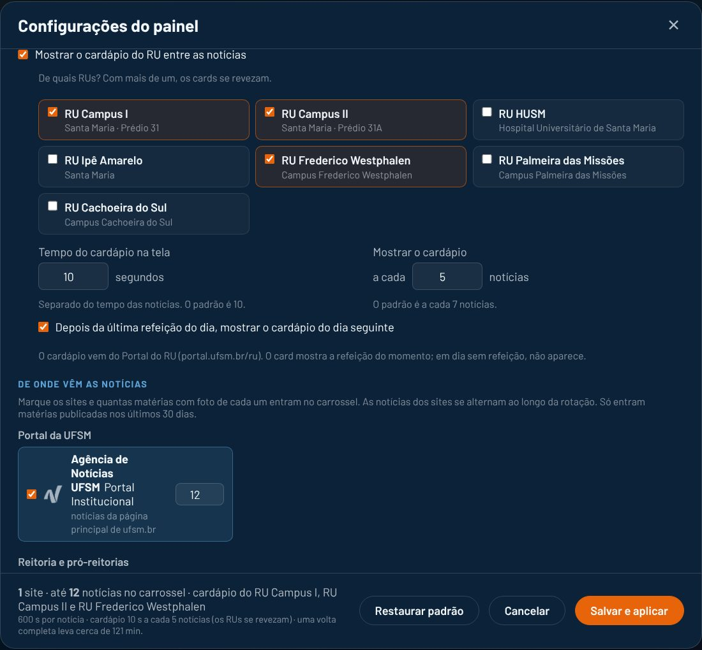

- **De quais RUs?** Campus I, Campus II, HUSM, Ipê Amarelo, Frederico Westphalen, Palmeira das
  Missões e Cachoeira do Sul — os mesmos do [Portal do RU](https://portal.ufsm.br/ru/cardapio.html).
  Dá para marcar mais de um: a cada vez que o cardápio entra, vêm os cards de todos os RUs
  marcados agrupados, um depois do outro (ex.: RU Campus I e, em seguida, RU Campus II).
- **Tempo do cardápio na tela.** Separado do tempo das notícias: de 4 a 60 segundos, padrão 10.
- **Mostrar o cardápio a cada N notícias.** De 2 a 30, padrão 7. Com menos notícias que isso,
  o cardápio entra uma vez, no fim da volta.
- **Depois da última refeição do dia, mostrar o cardápio do dia seguinte.** Marcado (padrão),
  depois do jantar o card passa a mostrar o café da manhã de amanhã. Desmarcado, o card some até
  a próxima refeição.

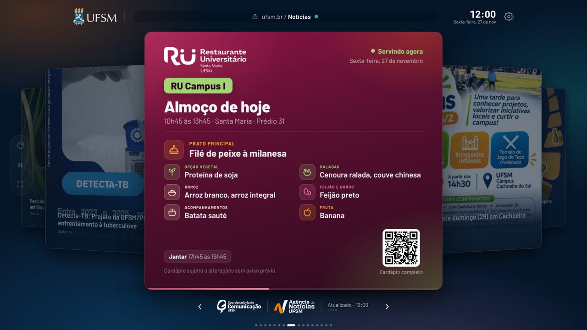
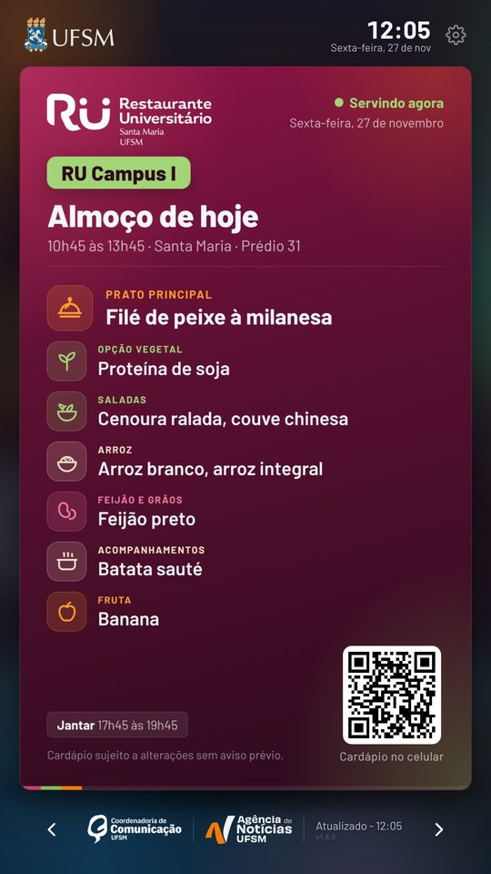

Como o card funciona:

- O **nome do RU** vem em destaque, numa etiqueta verde logo acima da refeição.
- Mostra a **refeição do momento**: a que está sendo servida (*Servindo agora*), a próxima do dia
  (*Próxima refeição*) ou, depois da última, a primeira do dia seguinte (*Amanhã*). Embaixo, as
  outras refeições que ainda vêm no mesmo dia, com o horário.
- **Horários** de RU Campus I (dias úteis: café 6h50–8h45, almoço 10h45–13h45, jantar
  17h45–19h45; fim de semana: 8h–9h30, 11h30–13h30, 18h–19h30) e RU Campus II (almoço
  10h45–13h45), conforme o site do RU. Para os outros RUs o horário não aparece e o painel usa
  janelas aproximadas só para escolher a refeição. Nas férias e no recesso, quando o horário
  muda, vale o que o RU divulgar.
- **Categorias com ícone**: prato principal, opção vegetal, saladas, arroz, feijão e grãos,
  acompanhamentos, sobremesa e fruta (no café: bebidas, pães, para acompanhar e fruta). O portal
  não informa a categoria: o painel deduz pelo nome do prato e pelas marcações de origem animal e
  vegetal do próprio portal. Temperos, água e açúcar ficam de fora.
- **Identidade do RU**: marca branca do RU com o nome do campus (Santa Maria, Frederico
  Westphalen, Palmeira das Missões ou Cachoeira do Sul), da
  [identidade institucional](https://www.ufsm.br/identidade-institucional), e fundo nas cores dela
  — fica claro que é um card de serviço, não uma notícia. Cada refeição tem a sua cor:
  **café da manhã em âmbar** (o laranja dos pingos do "ü"), **almoço em vinho e framboesa** e
  **jantar em verde-noite** (os verdes do "U"). A etiqueta com o nome do RU, os ícones e a barra
  de progresso acompanham: creme, verde e laranja na etiqueta; laranja, rosa e verde na barra.

  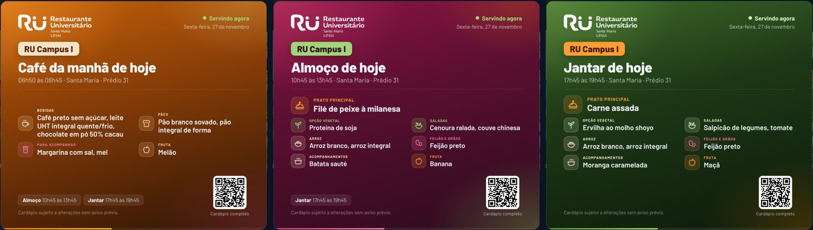
- O QR code leva ao cardápio completo no Portal do RU.
- O cardápio é lido junto com as notícias, a cada 15 minutos, e guardado no computador: se a
  internet cair, o card continua com o último cardápio lido. Dia sem cardápio (RU fechado): o
  card não aparece.

Os **avisos do site do RU** (RU fechado, horários especiais, pesquisas) podem entrar como notícias:
marque *RU - Restaurante Universitário* em *Órgãos suplementares*, logo abaixo. Como esses avisos
quase nunca têm foto, entram com o fundo padrão do painel.

### De onde vêm as notícias

Cada site tem uma caixa para marcar e, ao lado, quantas matérias com foto dele entram no
carrossel (de 1 a 30). O símbolo ao lado de cada nome é o mesmo que aparece nos cards.

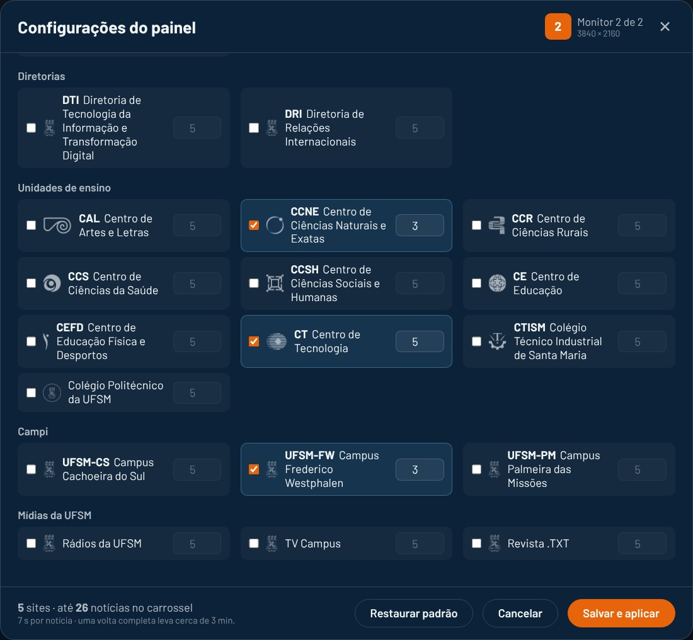

| Grupo | Sites | Símbolo |
|---|---|---|
| Portal da UFSM | Agência de Notícias UFSM – Portal Institucional (**marcado por padrão, 12 notícias**) | Agência de Notícias |
| Reitoria e pró-reitorias | Gabinete da Reitoria, PROGRAD, PRPGP, PRE, PRAE, PROGEP, PROPLAN, PRA, PROINFRA, PROINOVA | brasão da UFSM em linhas |
| Diretorias | DTI, DRI | brasão da UFSM em linhas |
| Unidades de ensino | CAL, CCNE, CCR, CCS, CCSH, CE, CEFD, CT, CTISM, Colégio Politécnico | símbolo de cada unidade |
| Campi | UFSM-CS (Cachoeira do Sul), UFSM-FW (Frederico Westphalen), UFSM-PM (Palmeira das Missões) | brasão da UFSM em linhas |
| Mídias da UFSM | Rádios da UFSM, TV Campus, Revista .TXT | brasão da UFSM em linhas |

**TV Campus:** entram primeiro os vídeos do YouTube em destaque na página inicial do site (TV
Campus Entrevista, TVC…), na ordem em que aparecem lá. O título vem do próprio YouTube, a editoria
é o programa e a capa do vídeo aparece como a foto das matérias; o QR code abre o vídeo no
celular. Esses vídeos não têm data, então valem enquanto estiverem na página inicial. Depois vêm
as matérias recentes do site — as que só têm vídeo também entram com a capa do YouTube.

Como as notícias são escolhidas:

- **Portal:** primeiro as notícias da página principal de ufsm.br (banners do topo, Destaques,
  Divulga Ciência…); se forem menos que a quantidade marcada, completa com as últimas matérias do portal.
- **Demais sites:** as últimas matérias com foto publicadas em cada um.
- **Só notícia recente:** matérias com mais de 30 dias ficam de fora. Um site que não publica há
  mais de um mês não aparece no carrossel até publicar de novo — por isso o total pode ficar
  abaixo do que foi marcado.
- **Alternância:** as notícias dos sites se intercalam (portal, CT, campus, portal…), para variar
  ao longo da volta.
- **Sem repetição:** uma matéria publicada em dois sites com o mesmo título aparece uma vez só.
- **Site sem nada recente:** depois de uma busca, os sites marcados que não trouxeram matéria
  aparecem com o aviso *sem matérias com foto nos últimos 30 dias* (ou *não respondeu*). Se
  nenhum dos sites escolhidos tiver matéria recente e o portal estiver desmarcado, o painel mostra
  as notícias do portal para a tela não ficar vazia, e avisa no topo.

### Versão e atualizações

No fim da tela de configurações aparece a versão instalada e o botão **Buscar atualização**, para
não precisar esperar a busca automática (que acontece 1 minuto depois de abrir e a cada 6 horas).

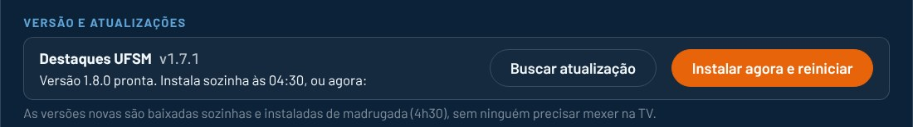

- **Windows e AppImage:** se houver versão nova, ela é baixada na hora (com o andamento em %) e
  fica pronta para instalar de madrugada, às 4h30. Para instalar já, use **Instalar agora e
  reiniciar**: o painel fecha, atualiza e abre de novo sozinho, com as mesmas opções.
- **Linux com .deb ou .rpm:** instalar precisa da senha de administrador, então o painel só avisa
  que há versão nova e onde baixar.
- **Versão para navegador:** o botão confere a última versão publicada no GitHub e avisa se há
  uma mais nova para baixar.

### Salvar

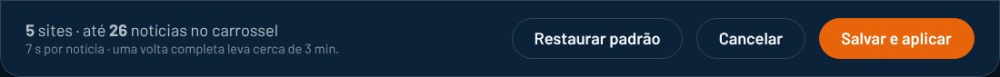

O rodapé mostra quantos sites estão marcados, quantas notícias **no máximo** entram no carrossel
e quanto tempo leva uma volta completa, com o tempo escolhido para cada notícia. É preciso marcar
pelo menos um site.

- **Salvar e aplicar** guarda a configuração e já busca as notícias de novo, sem reiniciar o painel.
- **Restaurar padrão** volta ao portal com 12 notícias e apaga o nome da TV (só vale depois de salvar).
- **Cancelar** fecha sem mudar nada.

### Resultado

Abaixo do título de cada matéria aparece o site de onde ela vem, com sigla, nome completo e o
símbolo da unidade:

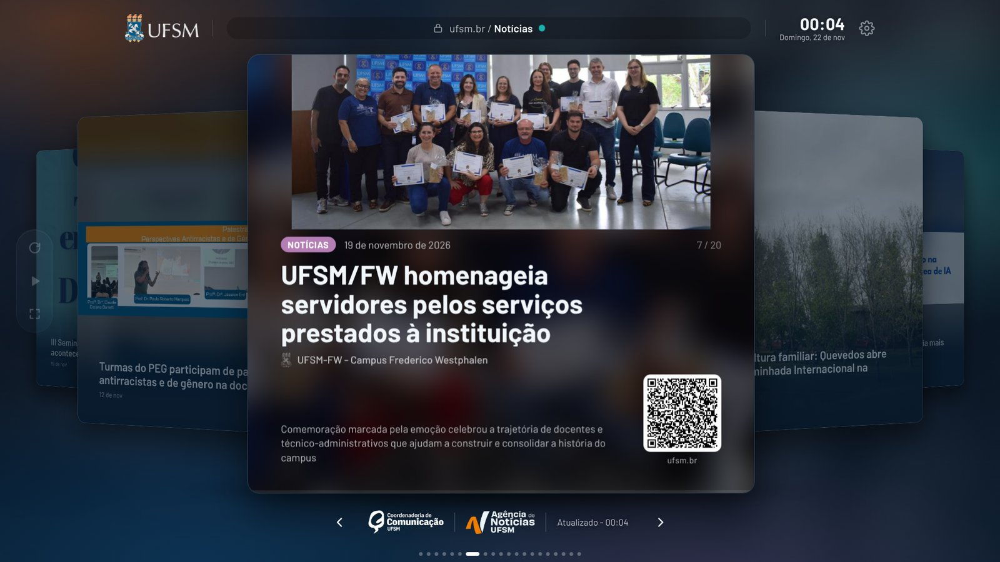

> As opções `--quantidade`, `--sites`, `--porsite`, `--local` e `--intervalo` (veja [Opções](#opções)) valem por
> cima do que foi salvo na tela de configurações — úteis para configurar várias TVs pelo atalho.

## Uso

### Atalhos

| Tecla | Ação |
|---|---|
| ← / → | notícia anterior / próxima |
| Espaço | pausa / continua |
| R | busca as notícias agora |
| C | tela de configurações |
| M | liga / pausa a rádio UNIFM (quando o player está ligado) |
| 1 / 2 / 3 | leva o painel para o monitor 1, 2 ou 3 (da esquerda para a direita) e lembra a escolha |
| F11 / Esc | entra / sai da tela cheia |
| Ctrl+R | recarrega o painel |
| Ctrl+Q | fecha o aplicativo |

Em telas de toque, deslize o dedo para os lados para trocar de notícia.

### Opções

Acrescente ao atalho (Windows, campo "Destino") ou ao comando (Linux):

| Opção | O que faz |
|---|---|
| `--monitor=2` | abre no segundo monitor só desta vez (para fixar, use as teclas 1, 2, 3) |
| `--intervalo=12` | segundos por notícia (padrão 10). Também na tela de configurações |
| `--cidade=santa-maria` | previsão do tempo ao lado do relógio: `santa-maria`, `frederico-westphalen`, `palmeira-das-missoes` ou `cachoeira-do-sul`. Também na tela de configurações |
| `--atualizacao=10` | minutos entre as leituras do portal (padrão 15) |
| `--quantidade=12` | notícias do portal (padrão 12; se a página principal tiver menos, completa com as últimas matérias do portal). Também na tela de configurações |
| `--sites=unidades-universitarias/ct,pro-reitorias/prograd` | inclui as últimas matérias desses subsites (5 de cada; `--porsite=10` muda). O mais simples é marcar na tela de configurações |
| `--max=30` | número máximo de notícias |
| `--dias=30` | idade máxima das matérias, em dias (padrão 30) |
| `--secoes=Destaques,JAI` | mostra só estas áreas da página principal |
| `--ignorar="Em destaque"` | tira áreas (ex.: os banners do topo) |
| `--orientacao=vertical` | força o layout de totem (normalmente é automático) |
| `--leve=1` | sem efeitos de desfoque, para computadores mais fracos |
| `--noite=23-6` | tela preta das 23h às 6h |
| `--local=ct` | nome desta TV, para medir as leituras do QR code (`utm_campaign`). Também na tela de configurações |
| `--sem-atualizacao` | não procura versões novas |
| `--iniciar-com-sistema` | passa a abrir sozinho ao entrar no computador (guarda as outras opções) |
| `--nao-iniciar-com-sistema` | desfaz a opção acima |

Exemplo no Windows: `"%LOCALAPPDATA%\Programs\DestaquesUFSM\DestaquesUFSM.exe" --intervalo=12`

### Versão para navegador

[`destaques-ufsm.html`](navegador/destaques-ufsm.html) é o mesmo painel em um único arquivo, para abrir em qualquer navegador
(Chrome ou Edge em modo quiosque, por exemplo). As opções vão no endereço:
`destaques-ufsm.html?intervalo=12&orientacao=vertical`. A troca de monitor pelas teclas 1, 2 e 3
existe só no aplicativo.

## Como funciona

```
 www.ufsm.br ──(API pública do WordPress, a cada 15 min)──▶ painel (HTML + JavaScript)
                                                             │
                     lê a página principal, encontra as matérias com foto,
                     escolhe a melhor imagem e monta o carrossel
                     (poucas notícias? plano B: últimas matérias pela API)
                                                             │
                                                             ▼
                          aplicativo Electron: tela cheia, tela sempre acesa,
                          abrir com o sistema, monitores, recuperação automática,
                          atualização automática pelas Releases do GitHub
```

O painel é uma página HTML + JavaScript que roda no próprio computador da TV. Ele lê a página
principal do portal pela API pública do WordPress da UFSM, identifica as matérias com foto
(endereços no formato `/AAAA/MM/DD/titulo`), escolhe a melhor imagem de cada uma e monta o
carrossel. O aplicativo para Windows e Linux é feito com [Electron](https://www.electronjs.org):
ele abre essa página em tela cheia e cuida do que um navegador comum não faz sozinho.

### Teste diário do portal

O painel depende do layout da página principal do portal. Todo dia às 7h17, o GitHub Actions
([`.github/workflows/portal.yml`](.github/workflows/portal.yml)) abre o painel contra o site real e
confere se ele encontra pelo menos 5 notícias, todas com título, foto e site de origem — e se o
plano B pela API também funciona. Se algo falhar, a execução fica vermelha e o GitHub avisa por
e-mail; o resumo de cada execução lista as notícias encontradas. Para rodar à mão:
**Actions › Teste do portal › Run workflow**, ou, no computador, `npm run teste:portal`
(precisa do [Playwright](https://playwright.dev): `cd testes && npm install --no-save playwright`
e `npx playwright install chromium`).

## Desenvolvimento

Requisitos: [Node.js LTS](https://nodejs.org) e [Git](https://git-scm.com).

```bash
git clone https://github.com/danielcarli/Totem-UFSM-noticias.git
cd Totem-UFSM-noticias
npm install
npm start            # abre o painel
npm run painel       # gera app/index.html e navegador/destaques-ufsm.html a partir de painel/
npm run teste:portal # testa o painel contra o portal real (veja "Teste diário do portal")
npm run dist:win     # instalador (Setup.exe) e versão portátil (.zip) do Windows
npm run dist:linux   # .deb, .rpm e AppImage
npm run dist         # todos
```

Os arquivos ficam em `dist/`, já com os nomes usados nos links de [Download](#download).
Os instaladores são gerados com [electron-builder](https://www.electron.build) (no Windows, com
o NSIS). Para gerar o `.rpm` é
preciso o `rpmbuild` (pacote `rpm`); para gerar o instalador do Windows a partir do Linux, o
`wine`.

### Estrutura do projeto

O painel é editado em **`painel/template.html`**. Depois de mudar o template ou as marcas,
rode `npm run painel` (os comandos `dist` já fazem isso).

```
painel/template.html   o painel: HTML, CSS e JavaScript (é aqui que se edita)
painel/marcas/         marcas da UFSM, da Coordenadoria e da Agência usadas no painel
painel/marcas/origens/ símbolos das unidades ao lado do site de origem (branco sobre transparente)
scripts/               geração do painel a partir do template e publicação no GitHub
main.js                aplicativo Electron (janela, atalhos, opções, monitores, abrir com o sistema)
app/index.html         o painel gerado para o aplicativo (fontes e QR code locais)
navegador/             o painel gerado em arquivo único, para navegador
app/fontes/            fonte Barlow
app/vendor/            gerador de QR code
build/                 ícones, licença e personalização do instalador do Windows
docs/                  imagens deste README
testes/                teste do painel contra o portal real
sistema/               Destaques UFSM – Sistema: scripts (raiz/), pacote .deb e imagem ISO (live/)
LEIA-ME.txt            instruções que acompanham os instaladores
.github/workflows/     geração e publicação automática dos instaladores
```

### Gerar o sistema próprio

```bash
npm run dist:linux                 # painel: dist/destaques-ufsm_amd64.deb
bash sistema/construir-deb.sh      # camada do sistema: dist/destaques-sistema_all.deb
sudo bash sistema/construir-iso.sh # imagem: dist/Destaques-UFSM-Sistema-amd64.iso (Debian 13 + live-build, ou Docker)
```

O GitHub Actions gera os dois `.deb` e a ISO a cada versão publicada (job `sistema` do
[`release.yml`](.github/workflows/release.yml)).

### Publicar uma versão

1. Descreva as novidades na tabela de [Versões](#versões).
2. Rode o script de publicação, na pasta do projeto:

   ```bash
   npm run publicar -- 1.9.5     # ou: patch (1.9.4 → 1.9.5), minor (→ 1.10.0), major (→ 2.0.0)
   ```

   No Windows também dá para dar dois cliques em **`publicar.cmd`** (publica a versão que está
   no `package.json`). O script:
   - liga a pasta ao repositório do GitHub, se ela veio de um `.zip` e ainda não é um repositório Git;
   - confere se a versão ainda não foi publicada e se o GitHub não tem mudanças que faltam aqui;
   - atualiza a versão no `package.json`, no `package-lock.json` e no selo do README;
   - gera o painel (`npm run painel`);
   - mostra os arquivos que mudaram e pergunta antes de enviar;
   - envia o código e a tag `v1.8.1`.

   Opções: `--teste` (só mostra o que faria), `--sem-tag` (envia o código sem gerar instaladores),
   `--mensagem "texto"` (mensagem do commit) e `--sim` (não pergunta). Precisa do
   [Git](https://git-scm.com); na primeira vez, o Git pede o login do GitHub.
3. A tag dispara o GitHub Actions ([`.github/workflows/release.yml`](.github/workflows/release.yml)),
   que gera os instaladores de Windows e Linux e os publica na release da versão em uns 10 a
   15 minutos. Os links de [Download](#download) passam a apontar para ela, e os painéis já
   instalados se atualizam sozinhos (pelos arquivos `latest.yml` e `latest-linux.yml` da release).

Também dá para publicar à mão: `git tag v1.8.1 && git push origin v1.8.1` depois de enviar o
código, ou gerar com `npm run dist` e criar a release em
[Releases](https://github.com/danielcarli/Totem-UFSM-noticias/releases/new), anexando os arquivos
de `dist/` e o `navegador/destaques-ufsm.html`, com os mesmos nomes.

## Versões

| Versão | Novidades |
|---|---|
| **1.9.4** | Sistema próprio: **Wi-Fi Broadcom** que o Linux não liga sozinho (BCM4312, BCM4313, BCM43224/43225/43227/43228, BCM4331 — comuns em notebooks de 2008 a 2014, como o Lenovo IdeaPad Z460) passa a funcionar com o driver wl, já na ISO; ao ligar (e no "Tentar de novo"), a placa Broadcom sem rede passa sozinha para esse driver. |
| **1.9.3** | Sistema próprio: quando o Wi-Fi não aparece, a engrenagem diz o motivo (chave do notebook desligada, placa sem driver ou nenhuma placa) e tem o botão "Tentar de novo", que tira os bloqueios de rádio (ex.: Fn+F5) e procura a placa de novo; o rádio do Wi-Fi é liberado ao ligar; o diagnóstico da recuperação mostra as placas de rede, os bloqueios e as mensagens de firmware. |
| **1.9.2** | QR code mais simples: link curto das matérias (`www.ufsm.br/?p=ID`), marcação do Google Analytics com valores curtos (`utm_source=tv`, `utm_medium=qr`) e correção de erro baixa — cerca de metade dos quadradinhos. |
| **1.9.1** | "ufsm.br / Notícias" continua no centro da tela quando a previsão do tempo aparece no topo. |
| **1.9.0** | Tempo padrão de cada notícia passa de 7 para 10 segundos. **Cardápio do RU** entre as notícias (a cada 7, 10 s na tela; um ou mais RUs, com os cards agrupados, e o nome do RU em destaque), com a marca e as cores do RU (âmbar no café, vinho no almoço, verde-noite no jantar) e ícones por categoria de alimento; avisos do site do RU como fonte de notícias. **Previsão do tempo** ao lado do relógio, pela cidade da TV (Open-Meteo, `--cidade`). Vídeos do YouTube incorporados na página principal entram no carrossel, com o nome do canal como autoria e a capa em alta resolução. |
| **1.8.0** | **Destaques UFSM – Sistema**: imagem ISO de um Debian 13 enxuto que liga direto no painel (PCs e notebooks de 64 bits, BIOS ou UEFI, notebook + TV), com instalador; rede cabeada, Wi-Fi (inclusive com usuário e senha), Bluetooth, som, telas e horário de funcionamento (apaga a tela e suspende fora do expediente, liga sozinho na abertura) pela engrenagem do painel; atualização pela Release do GitHub com SHA-256 e versão anterior guardada; recuperação com PIN (Ctrl+Alt+F2 ou menu de inicialização) e atualização forçada automática se o painel travar. |
| **1.7.1** | Botão **Buscar atualização** na tela de configurações, com a versão instalada, o andamento do download e **Instalar agora e reiniciar** quando a versão nova já foi baixada; teste diário fixo no Ubuntu 24.04; script de publicação tenta de novo quando a rede falha. |
| **1.7.0** | Tela de configurações (engrenagem ao lado do relógio ou tecla C): de onde vêm as notícias — portal com 12 por padrão e, se quiser, Gabinete da Reitoria, pró-reitorias, diretorias (DTI e DRI), unidades de ensino e campi, com a quantidade de cada um —, nome da TV, monitor (com o número do monitor atual) e tempo de cada notícia na tela; player da rádio UNIFM 107,9 ao vivo (desligado por padrão, tecla M); notícias das mídias da UFSM (Rádios, TV Campus, Revista .TXT), com os vídeos em destaque da TV Campus (título e capa do YouTube); quando os sites escolhidos não têm nada recente, mostra o portal em vez da tela vazia; símbolo da unidade ao lado do site de origem (Agência de Notícias, centros e colégios; brasão da UFSM em linhas para os demais); matérias com mais de 30 dias ficam de fora (`--dias`); origem do portal como "Agência de Notícias UFSM - Portal Institucional"; versão do painel discreta no rodapé; script `npm run publicar` para publicar no GitHub. |
| **1.5.0** | Atualização automática pelas Releases do GitHub (instala de madrugada e reabre com as mesmas opções); site de origem abaixo do título de cada matéria; carrossel com 30 notícias (completa com as últimas matérias do portal); leituras do QR code medidas no Google Analytics (`--local`); plano B pela API do WordPress quando a página principal muda de layout; teste diário contra o portal no GitHub Actions. |
| **1.4.4** | Notícias com GIF animado como imagem de destaque (ex.: "Lembre bem") também aparecem, com a animação no card; nesses casos o fundo desfocado não usa o GIF, para não pesar na placa de vídeo. |
| **1.4.3** | Corrige imagens piscando nas transições depois de várias trocas seguidas pelo teclado: o fundo desfocado troca sem piscar, os cards fora da tela deixam de ocupar a placa de vídeo (cerca de 1/3 menos área desenhada) e o card que chega ao centro só passa à frente quando cruza o anterior. |
| **1.4.2** | O título da matéria fica sempre embaixo da imagem: saiu a troca de posição com as setas ↑/↓ (e a opção `--layout`). |
| **1.4.1** | Banners do carrossel do topo que levam a uma página ou site (ex.: Descubra UFSM), e não a uma matéria, também entram no painel; correção da geração automática no Windows (GitHub Actions). |
| **1.4.0** | Instalador assistido para Windows (com opção de abrir ao iniciar) e pacotes `.deb`, `.rpm` e AppImage para Linux; teclas 1, 2 e 3 para trocar de monitor, com memória da escolha; hora da última atualização só no rodapé; licença GNU GPL 3. |
| **1.3.0** | Marca da UFSM no topo; Coordenadoria de Comunicação e Agência de Notícias no rodapé; card de notícia sem foto com mais contraste. |
| **1.2.0** | Layout para totem vertical, QR code maior, toque na tela, modo noite, recarga diária, instalador `.deb`. |

## Sugestões por fazer

Ideias para as próximas versões (contribuições são bem-vindas):

- [ ] **Siglas oficiais** do Gabinete da Reitoria e do Colégio Politécnico, se existirem, ao lado do nome.
- [ ] **Avisos urgentes**: uma mensagem institucional que ocupa a tela em todas as TVs (suspensão de aulas, alerta climático, mudança de horário).
- [ ] **Configuração central**: ajustar todas as TVs de um lugar só, sem ir até cada computador.
- [ ] **Painel de funcionamento**: cada TV informa que está ligada e mostrando notícias; aviso quando alguma parar.
- [ ] **Agenda de eventos** da UFSM entre as notícias.
- [ ] **Horários do RU nas férias e no recesso**, lidos dos avisos do site do RU.
- [ ] **Ligar e desligar a TV** por horário (HDMI-CEC), além da tela preta do modo noite.
- [ ] **Fotos guardadas no computador**, para continuar mostrando as notícias com a internet fora por mais tempo.
- [ ] **Vídeos** como destaque, quando a matéria tiver vídeo em vez de foto.
- [ ] **Instalador do Windows assinado** com certificado da UFSM, para o Windows não mostrar o aviso de "editor desconhecido".

## Créditos

Idealizado por **Daniel Michelon De Carli**, para a Agência de Notícias UFSM / Coordenadoria de
Comunicação da UFSM.

Encontrou um problema ou tem uma sugestão? Abra uma [issue](https://github.com/danielcarli/Totem-UFSM-noticias/issues).

## Licença

Copyright © 2026 UFSM — Coordenadoria de Comunicação / Agência de Notícias UFSM.

Este programa é software livre, distribuído sob a **GNU General Public License, versão 3** ou
(a seu critério) qualquer versão posterior. Veja o arquivo [LICENSE](LICENSE).

As marcas da UFSM, da Coordenadoria de Comunicação e da Agência de Notícias **não** são cobertas
por essa licença: pertencem à UFSM e só podem ser usadas conforme o manual de identidade visual
da instituição. As notícias e fotos exibidas pertencem aos seus autores e à UFSM.

Componentes de terceiros: Electron (MIT), Chromium (BSD e outras), fonte Barlow
(SIL Open Font License 1.1) e qrcode-generator (MIT).
